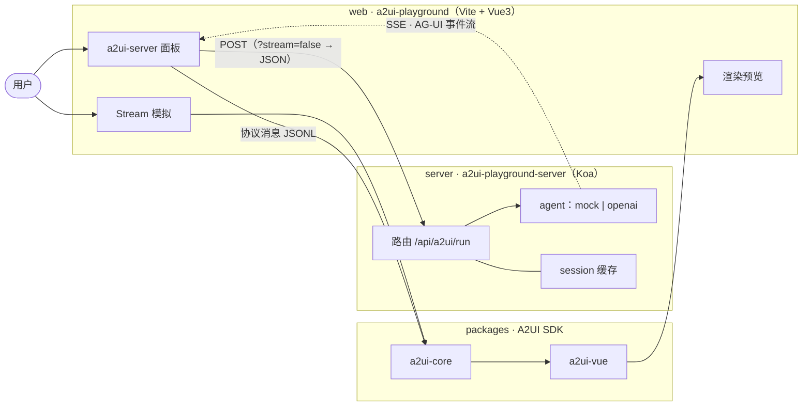
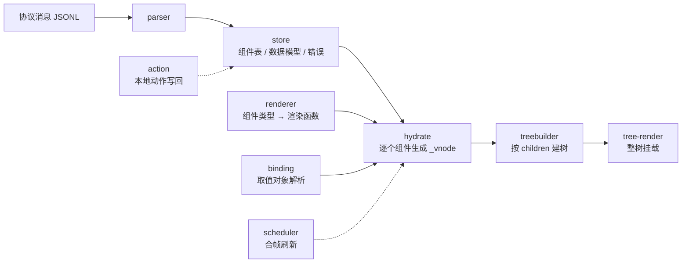
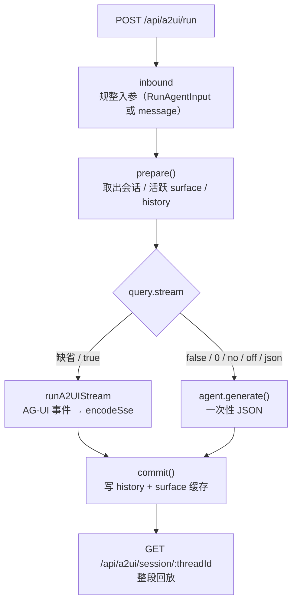

# A2UI

通过 AI 对话生成 UI 界面。

## 项目介绍

实现一个 A2UI 项目：用户通过 Web 应用与 agent 对话，服务端把自然语言输入转成 A2UI 协议消息，
前端逐条接收并流式渲染出可交互的界面。

## 项目架构

monorepo（pnpm workspace）组织代码，分三层：

| 层 | 目录 | 职责 |
| --- | --- | --- |
| SDK | `packages/` | A2UI 协议解析 + 渲染引擎，产出可发布的 npm 包 |
| Web | `web/` | Playground：对话、预览、协议调试 |
| Server | `server/` | 接收输入 → 调 agent → 产出 A2UI 协议消息 |

### 整体架构



两条数据来源（服务端 / 内置 mock）**最终走同一条解析与渲染链路** —— 这是整个设计里最重要的约束：
换数据来源不动渲染，改渲染也不动来源。

### 目录结构

```
packages
├── a2ui-core            协议解析 + 渲染引擎（与前端框架无关）
├── a2ui-vue             基于 Vue3 的渲染引擎
└── a2ui-ui-components   Vue3 组件库
web
└── a2ui-playground      Playground（Vite + Vue3）
server
└── a2ui-playground-server   agent 编排 + 协议生成 + 会话缓存（Koa）
```

## packages —— A2UI SDK

### a2ui-core

协议解析与渲染引擎，不依赖任何前端框架。

| 模块 | 职责 |
| --- | --- |
| `parser` | 解析 A2UI 协议。`parseA2UI` 一次性解析整段 JSONL；`createJSONLStream` 行框定流式解析；`createA2UIBuffer` 括号配对取完整值 —— **不等整条 `surfaceUpdate` 收完**，每有一个组件闭合就补成「一个组件一条完整消息」，做到边到边渲染；配套 `chunkText` / `simulateTextStream` 模拟字符流 |
| `store` | 基于 `zustand/vanilla` 的全局单例状态，`init()` 初始化 |
| `renderer` | 组件级渲染注册表：`组件类型名 → 渲染函数`，由渲染引擎在 init 时注入 |
| `treebuilder` | 按容器的 `children` 字段构建组件树 |
| `tree-render` | 树级渲染器：把整棵组件树交给宿主挂载 |
| `vnode` | 协议生成的组件到 vnode 的映射与管理 |
| `hydrate` | 水合：把已登记的节点组装成可渲染节点。渲染推迟到整段 JSONL 处理完，保证数据绑定已就位 |
| `binding` | 数据绑定：解析取值对象（`{ literalString }` / `{ path }` 二选一），并按 `path` 写回数据模型 |
| `action` | 客户端动作（`Button.action`）的协议语义。服务端分支组装 `userAction` 消息交宿主；本地分支（协议扩展 `type: "local"`）把 `local[]` 操作模拟成 `updateModel` 写回数据模型 |
| `scheduler` | 刷新调度：把流式期间密集的刷新请求合帧，每帧只做一次全量重算 |
| `error` | 错误记录入口：统一生成 id 并写入 `errorMap`，避免调用方各自造 id 重号 |
| `mock` | 自带示例协议（TS 模块，一行一条 JSONL 消息）。`data-binding` 是最小完整的数据绑定示例（TextField/CheckBox/Slider 写回 + Text 同 path 联动） |

**渲染管线**：从一条协议消息到页面上的一棵树。



`scheduler` 是关键的一环：`hydrate → 建树 → 重画` 是**全量**的，而流式推送可能比帧率还密，
所以刷新被合帧成「每帧只跑一次」。`action` 的本地分支也走这条链路 —— 写回数据模型后，
由同一次刷新把界面与数据对齐。

### a2ui-vue

基于 Vue3 的 A2UI 渲染引擎，用于在 Vue3 中使用 A2UI 组件库。

### a2ui-ui-components

Vue3 组件库。

## web —— a2ui-playground

Vite + Vue3 应用，通过 Vite alias 直接引用各包 `src`，改 SDK 无需先构建。

主要职责及详细功能：

1. 通过对话方式，让 AI Agent 生成对应的 UI 界面
2. 预览生成的页面
3. 支持多轮对话增量调整界面
4. 预览 a2ui-vue 定义的基础 A2UI 组件
5. 协议调试 —— **Stream 模拟**面板可逐条推送协议消息，观察边到边渲染过程
6. 对接服务端 —— **a2ui-server**面板提供「生成（非 SSE）」与「生成（SSE 流式）」两个按钮，直连本地服务端

## server —— a2ui-playground-server

接收用户输入 → 调用 agent → 产出 a2ui 协议（Koa）。

主要职责及详细功能：

1. **核心接口**：`POST /api/a2ui/run` —— 生成只有一个入口，传输方式由 query 决定：
   - 缺省 / `?stream=true`：**SSE**（`text/event-stream`，AG-UI 事件流）
   - `?stream=false`（也接受 `0` / `no` / `off` / `json`）：一次性 JSON
   - `POST /api/a2ui/generate`：上面那个的**固定别名**，省得脚本与测试记 query

   入站同时接受 AG-UI 的 `RunAgentInput`（`threadId` / `runId` / `messages`）与简写 `{ message }`。
2. **agent**：`mock`（离线假数据，当前默认）与 `openai` 两个实现，切换开关是 `AGENT_PROVIDER`；
   两者共用同一套「文本 → 协议消息」抽取与流式行装配，产出必然一致。
3. **缓存**：会话历史 + 按 surface 累积的协议消息，`GET /api/a2ui/session/:threadId` 可整段回放。

**请求管线**：生成只有一个入口，分流只发生在最后一刻。



`prepare()` 与 `commit()` 被两条传输路径共用，所以「入参怎么解析」「缓存什么」不会因传输方式分叉。
入参非法时 `prepare()` 会在**开流之前**抛错返回 400（符合 AG-UI：run 未开始就不能给事件流）。

传输细节、AG-UI 事件映射与环境变量见 [`docs/a2ui-server.md`](./docs/a2ui-server.md)。

## 快速开始

```bash
pnpm install

# 起 playground（默认 http://localhost:5173）
pnpm --filter a2ui-playground dev

# 另开终端：起服务端（默认 http://localhost:3000，agent 走离线 mock）
pnpm --filter a2ui-playground-server dev
```

接真实模型：

```bash
cd server/a2ui-playground-server
cp .env.example .env     # 填入 OPENAI_API_KEY，并把 AGENT_PROVIDER 设为 openai
pnpm dev
```

根目录常用命令：

```bash
pnpm build   # 递归构建全部包
pnpm dev     # 递归并行启动各包 dev
pnpm test    # 递归运行全部测试
```

## 文档

| 文档 | 内容 |
| --- | --- |
| [`docs/a2ui-server.md`](./docs/a2ui-server.md) | 服务端接口、AG-UI 事件映射、环境变量、测试覆盖 |
| [`docs/a2ui-component-protocol.md`](./docs/a2ui-component-protocol.md) | 现有 renderer 支持的 A2UI 标准组件协议 |
| [`docs/a2ui-local-action-extension.md`](./docs/a2ui-local-action-extension.md) | 本地动作协议扩展（`type: "local"`）的说明与兼容性代价 |

## 技术栈

- 所有项目均使用 TypeScript。
- **包管理**：pnpm。`.npmrc` 设 `node-linker=hoisted`，避开 Windows 下传递依赖链接异常。
- **web**：使用 Vite 构建 playground 应用。
- **server**：使用 Koa 实现服务接口；agent 基于 OpenAI；使用 ts-node 运行。
