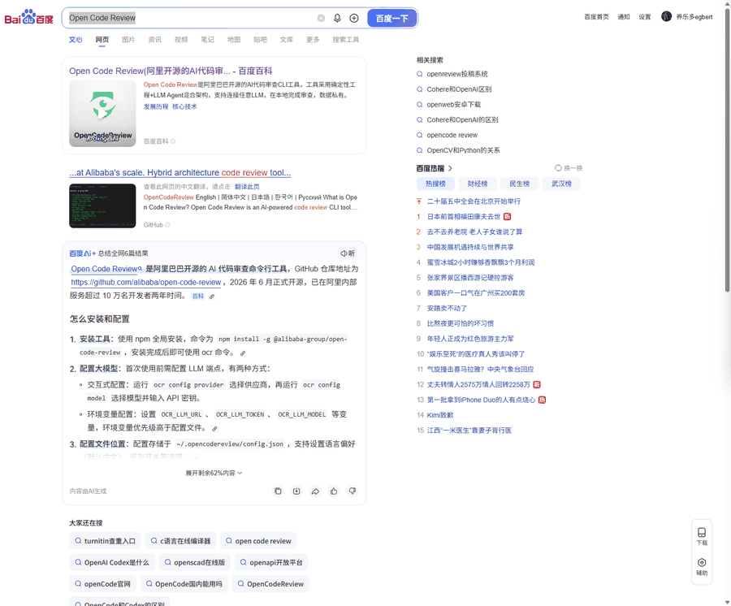
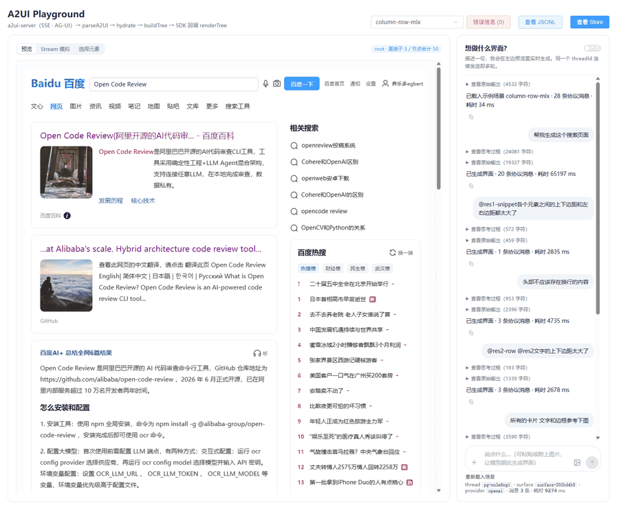
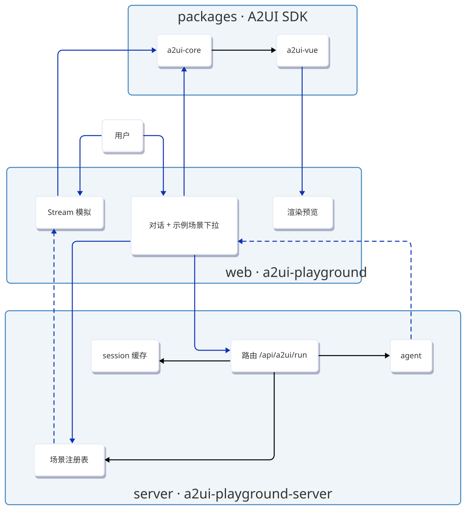

# A2UI

通过 AI 对话生成 UI 界面。

## 项目介绍

实现一个 A2UI 项目：用户通过 Web 应用与 agent 对话，服务端把自然语言输入转成 A2UI 协议消息，
前端逐条接收并流式渲染出可交互的界面。

## 效果展示

**一句话 + 一张参考图 → A2UI 协议 → 端上流式渲染。**

### 案例一：搜索页复刻（复杂版面）

给 agent 一张百度搜索页的截图：三段式布局、图文混排的结果卡片、右侧相关搜索与 13 条热搜榜。
第一轮产出 **20 条协议消息、耗时 65 秒**，预览区逐块长出；

随后是**多轮增量调整**——每轮只发 1~3 条协议消息、耗时 3~5 秒，界面定点改，不重画：
「各个元素之间的上下边距和左右边距都太大了」→「头部不应该存在换行的内容」→「所有的卡片文字和边框参考下面图」。
对话里的 `@res1-snippet`、`@res2-row` 是**在预览区点选组件**带进去的组件 id（Alt + 点击可直接选取）。

**① 输入：参考图**



**② 输出：Playground 复刻结果（左预览 / 右对话，含每轮协议消息数与耗时）**



### 案例二：天气卡片（最小闭环）

一次真实生成：9 条协议消息、31.8 秒，含 1.3 万字符的思考过程。

**① 输入：一张参考图（多模态上传）**


**② 输出：Playground 三块 —— 左上预览逐块长出、左下数据模型绑定（path 实时解析）、右侧对话（协议消息与耗时）**


## 在线体验

**https://yakult.work/** —— 腾讯云 Lighthouse（Ubuntu 24.04，2C2G），跑的是真实模型
（DeepSeek `deepseek-flash`），不是 mock。打开就是 playground，左栏输入一句话即可生成。

| 项 | 值 |
| --- | --- |
| 地址 | **https://yakult.work/**（docker compose；80/443 归网关独占，后续服务走 `127.0.0.1:<端口>` 由网关分流） |
| 形态 | `a2ui-gateway`（Caddy，唯一占 80/443）→ `a2ui-web`（nginx，只绑 `127.0.0.1:8080`）→ `a2ui-server`（Node，仅内网） |
| 证书 | Let's Encrypt **域名证书**（`yakult.work` / `www`，2027-01-16 到期，`certbot.timer` 自动续 + `caddy reload`，浏览器无告警）。整棵 `/etc/letsencrypt` 只读挂进网关 |
| 模型 | `AGENT_PROVIDER=openai`，Key 只在服务器 `.env`（权限 600，不进仓库、不进镜像） |
| 自检 | `curl https://yakult.work/api/a2ui/scenarios`（返回 200 即前端容器 + 后端容器都通） |

> 历史上用 `https://<IP>/` 访问过：那时域名被备案网关拦（http 302 到 dnspod webblock、https 按 SNI 直接 reset），
> 只能靠 IP。**现在域名的拦截已经不再出现**（`http://yakult.work` 由网关 308 跳 https，证书校验通过），
> 而 **IP 证书是 7 天短效的，已经过期**（`https://<IP>/` 会报证书过期）——访问请统一用域名。

运维命令（`sudo` 执行）：

```bash
cd /opt/a2ui/deploy/docker
sudo bash up.sh                        # 构建 + 启动 + 自检（幂等，改完代码就跑它）
sudo docker compose ps                 # 容器状态与端口
sudo docker compose logs -f web server # 看日志
sudo docker compose restart gateway    # 只重启网关（改了 Caddyfile/证书）
sudo docker compose exec gateway caddy reload --config /etc/caddy/Caddyfile --adapter caddyfile  # 无中断重载
sudo docker compose down               # 停栈（保留镜像）
sudo bash renew-cert.sh                # 证书续期（自动 reload 网关）
sudo bash retire-legacy.sh             # 下线旧的宿主 nginx + pm2，释放 80/443
```

完整部署步骤、端口/证书/续期细节与排障表见 [`deploy/README.md`](./deploy/README.md)。

## 项目架构

monorepo（pnpm workspace）组织代码，分三层：

| 层 | 目录 | 职责 |
| --- | --- | --- |
| SDK | `packages/` | A2UI 协议解析 + 渲染引擎，产出可发布的 npm 包 |
| Web | `web/` | Playground：对话、预览、协议调试 |
| Server | `server/` | 接收输入 → 调 agent → 产出 A2UI 协议消息 |

### 整体架构



两条来路（**示例场景**与**自由输入**）在服务端汇成同一个出口，客户端也只有一条解析与渲染链路 ——
这是整个设计里最重要的约束：加数据来源不动渲染，改渲染也不动来源。

### 目录结构

```
packages
├── a2ui-core            协议解析 + 渲染引擎（与前端框架无关）
├── a2ui-vue             基于 Vue3 的渲染引擎
└── a2ui-ui-components   Vue3 组件库
web
└── a2ui-playground      Playground（Vite + Vue3）
server
└── a2ui-playground-server   agent 编排 + 协议生成 + 会话缓存（Koa）
```

## packages —— A2UI SDK

### a2ui-core

协议解析与渲染引擎，不依赖任何前端框架。

| 模块 | 职责 |
| --- | --- |
| `parser` | 解析 A2UI 协议。`parseA2UI` 一次性解析整段 JSONL；`createJSONLStream` 行框定流式解析；`createA2UIBuffer` 括号配对取完整值 —— **不等整条 `surfaceUpdate` 收完**，每有一个组件闭合就补成「一个组件一条完整消息」，做到边到边渲染；配套 `chunkText` / `simulateTextStream` 可把一段文本切成字符流跑起来（playground 现在改用服务端的 `scenarios/:id/stream`，这套留在 SDK 里备离线使用） |
| `store` | 基于 `zustand/vanilla` 的全局单例状态，`init()` 初始化 |
| `renderer` | 组件级渲染注册表：`组件类型名 → 渲染函数`，由渲染引擎在 init 时注入 |
| `treebuilder` | 按容器的 `children` 字段构建组件树 |
| `tree-render` | 树级渲染器：把整棵组件树交给宿主挂载 |
| `vnode` | 协议生成的组件到 vnode 的映射与管理 |
| `hydrate` | 水合：把已登记的节点组装成可渲染节点。渲染推迟到整段 JSONL 处理完，保证数据绑定已就位 |
| `binding` | 数据绑定：解析取值对象（`{ literalString }` / `{ path }` 二选一），并按 `path` 写回数据模型 |
| `action` | 客户端动作（`Button.action`）的协议语义。服务端分支组装 `userAction` 消息交宿主；本地分支（协议扩展 `type: "local"`）把 `local[]` 操作模拟成 `updateModel` 写回数据模型 |
| `scheduler` | 刷新调度：把流式期间密集的刷新请求合帧，每帧只做一次全量重算 |
| `error` | 错误记录入口：统一生成 id 并写入 `errorMap`，避免调用方各自造 id 重号 |
| `mock` | 自带示例协议（TS 模块，一行一条 JSONL 消息）。`data-binding` 是最小完整的数据绑定示例（TextField/CheckBox/Slider 写回 + Text 同 path 联动） |

**渲染管线**：从一条协议消息到页面上的一棵树。



`scheduler` 是关键的一环：`hydrate → 建树 → 重画` 是**全量**的，而流式推送可能比帧率还密，
所以刷新被合帧成「每帧只跑一次」。`action` 的本地分支也走这条链路 —— 写回数据模型后，
由同一次刷新把界面与数据对齐。

### a2ui-vue

基于 Vue3 的 A2UI 渲染引擎，用于在 Vue3 中使用 A2UI 组件库。

### a2ui-ui-components

Vue3 组件库。

## web —— a2ui-playground

Vite + Vue3 应用，通过 Vite alias 直接引用各包 `src`，改 SDK 无需先构建。

页面是**左侧舞台 + 右侧聊天栏**的双栏布局（整页不滚动，两栏各自内部滚动）。

主要职责及详细功能：

1. **示例场景全走接口** —— 顶部下拉的示例由服务端提供（`GET /api/a2ui/scenarios`），选中即走一次 SSE 运行。示例数据与自由输入共用同一条链路，**不存在「本地渲染」的第二套**。当前只保留一份示例：**天气页（武汉）**，它是一次真实生成的结果，含 15 天预报 / 逐小时 / 生活服务与四个本地动作。
2. 通过对话方式，让 AI Agent 生成对应的 UI 界面
3. 预览生成的页面
4. 支持多轮对话增量调整界面
5. 预览 a2ui-vue 定义的基础 A2UI 组件
6. **Stream 模拟** —— 顶部开关，控制协议消息**怎么回来**：
   - **流式（默认开）**：消息逐条到达即 ingest，预览区逐块长出；
   - **整体（关）**：先攒齐全部消息再一次性 ingest，预览一次性出现。
   过程明细（逐条 / 字符流两条模式、顺序、块长、逐条日志）收在预览底部的折叠块里，数据都来自服务端。
7. 对接服务端 —— 右侧 **聊天栏**里用输入框 + 发送键走 SSE 流式，收到的协议消息喂进同一套解析链路，组件在左侧预览区一个个长出来
   多轮由前端自带历史。用于把 baseURL / Key / 模型名这三件事单独验一遍（未配 Key 时
   气泡里直接显示服务端 503 的原话，写明了该改哪个文件）

## server —— a2ui-playground-server

接收用户输入 → 调用 agent → 产出 a2ui 协议（Koa）。

主要职责及详细功能：

1. **核心接口**：`POST /api/a2ui/run` —— 生成只有一个入口，传输方式由 query 决定：
   - 缺省 / `?stream=true`：**SSE**（`text/event-stream`，AG-UI 事件流）
   - `?stream=false`（也接受 `0` / `no` / `off` / `json`）：一次性 JSON
   - `POST /api/a2ui/generate`：上面那个的**固定别名**，省得脚本与测试记 query

   入站接受三种形状：AG-UI 的 `RunAgentInput`（`threadId` / `runId` / `messages`）、
   简写 `{ message }`、示例场景 `{ scenario }`。三者最终汇成同一份入参。
2. **示例场景**：内置 fixture（来自 `a2ui-core/mock`，当前是天气页一份）经接口提供 ——
   `GET /api/a2ui/scenarios` 列场景、`GET /api/a2ui/scenarios/:id` 取原始素材、
   `GET /api/a2ui/scenarios/:id/stream` 把素材按固定块长**字符级**吐出来（`?order=` / `?chunk=` / `?delay=` 可调）、
   `run` 带 `scenario` 即由 fixture 产出。三条刻意的规则：**场景永远走 fixture，与
   `AGENT_PROVIDER` 无关**（它是素材不是模型产出）；跑在 **fixture 自带的 surfaceId** 上
   （不是场景 id，两者可能不同名）；**不夺走会话的活跃 surface**。
3. **agent**：`mock`（离线假数据，当前默认）与 `openai` 两个实现，切换开关是 `AGENT_PROVIDER`；
   两者共用同一套「文本 → 协议消息」抽取与流式行装配，产出必然一致。
4. **图标按需查（MCP）**：`Icon` 的图标名用 Element Plus 图标库导出名，但**清单不进 system prompt**——
   agent 侧挂了一个图标 MCP 工具（`searchIcons` / `listIcons` / `getIcon`），模型生成图标前按需查询，
   中文概念（「购物车」）直接映射到真实导出名（`ShoppingCart`）。开关 `AGENT_ICON_TOOLS`，
   同一 MCP Server 也能独立跑 stdio 给外部客户端用。详见 `docs/a2ui-agent-prompt.md` §4。
5. **模型对话**：`POST /api/a2ui/chat` —— **独立的一条路**，只跟模型说话、不产出任何 A2UI 协议。
   用途是排掉协议层与渲染层的变量，单独验证「baseURL + Key + 模型名」通不通：
   未配 Key 返回 503（开流之前），成功则流回模型原话（失败走流内 `RUN_ERROR`）。
   默认接 DeepSeek（`OPENAI_BASE_URL=https://api.deepseek.com` / `OPENAI_MODEL=deepseek-flash`），
   换网关只改 `.env`。**无状态**：多轮由调用方带全 `messages`。
6. **动作回传**：`POST /api/a2ui/action` —— 按钮点击的**另一半**。渲染层把服务端动作派发成
   `a2ui-action` DOM 事件，宿主转发到这里；服务端按注册的 handler 产出 `dataModelUpdate` /
   `surfaceUpdate`，客户端 ingest 回去，界面与数据模型随即变化。**没注册 handler 也有回执**
   （写数据模型的 `__lastAction`），所以任何点击都能看到反应，而不是石沉大海。
7. **缓存**：会话历史 + 按 surface 累积的协议消息，`GET /api/a2ui/session/:threadId` 可整段回放。

**请求管线**：生成只有一个入口，分流只发生在最后一刻。



`prepare()` 与 `commit()` 被两条传输路径共用，所以「入参怎么解析」「缓存什么」不会因传输方式分叉。
入参非法时 `prepare()` 会在**开流之前**抛错返回 400（符合 AG-UI：run 未开始就不能给事件流）。

传输细节、AG-UI 事件映射与环境变量见 [`docs/a2ui-server.md`](./docs/a2ui-server.md)。

## 快速开始

```bash
pnpm install

# 起 playground（默认 http://localhost:5173）
pnpm --filter a2ui-playground dev

# 另开终端：起服务端（默认 http://localhost:3000，agent 走离线 mock）
pnpm --filter a2ui-playground-server dev
```

接模型（服务端 `.env` 里默认已经配好 DeepSeek 的地址与模型名，只差 Key）：

```bash
cd server/a2ui-playground-server
cp .env.example .env     # 填入 OPENAI_API_KEY（或 DEEPSEEK_API_KEY）

# 只测模型链接：不用改 AGENT_PROVIDER，重启后直接打
curl -N -X POST http://localhost:3000/api/a2ui/chat \
  -H 'Content-Type: application/json' -d '{"message":"用一句话介绍你自己"}'

# 让 A2UI 生成也走真实模型：把 .env 里的 AGENT_PROVIDER 改成 openai 再重启
pnpm dev
```

playground 里也能测：右栏标题右侧的 **「对话 / 界面」开关**，切到「对话」后发送键只打模型，
不生成界面、不动左侧预览。

> 实测（DeepSeek `deepseek-flash`）：对话逐 token 流式、首字 ~2.7s；把 `.env` 的
> `AGENT_PROVIDER` 设为 `openai` 后，一句话能产出 3 条协议消息 / 11 个组件并在预览里渲染出来
> （约 5.7s，抽取零丢行）。

根目录常用命令：

```bash
pnpm build   # 递归构建全部包
pnpm dev     # 递归并行启动各包 dev
pnpm test    # 递归运行全部测试
```

## 文档

| 文档 | 内容 |
| --- | --- |
| [`docs/a2ui-server.md`](./docs/a2ui-server.md) | 服务端接口、AG-UI 事件映射、环境变量、测试覆盖 |
| [`docs/a2ui-component-protocol.md`](./docs/a2ui-component-protocol.md) | 现有 renderer 支持的 A2UI 标准组件协议 |
| [`docs/a2ui-local-action-extension.md`](./docs/a2ui-local-action-extension.md) | 本地动作协议扩展（`type: "local"`）的说明与兼容性代价 |

## 技术栈

- 所有项目均使用 TypeScript。
- **包管理**：pnpm。`.npmrc` 设 `node-linker=hoisted`，避开 Windows 下传递依赖链接异常。
- **web**：使用 Vite 构建 playground 应用。
- **server**：使用 Koa 实现服务接口；agent 基于 OpenAI；使用 ts-node 运行。
